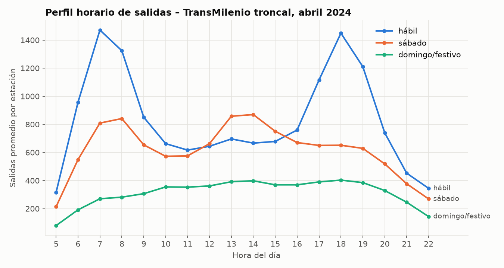

# Descripción de los datos

**Proyecto:** Predicción del nivel de congestión en estaciones troncales de TransMilenio con árboles de decisión
**Curso:** Inteligencia Artificial – Actividad 5 (aprendizaje supervisado)

Este documento describe la fuente de datos usada, su estructura original, el proceso de limpieza y transformación, y el dataset final con el que se entrena el modelo.

---

## 1. Relación con el proyecto de transporte masivo

En las actividades anteriores el equipo construyó un sistema experto que encuentra la mejor ruta entre dos estaciones de TransMilenio (base de conocimiento con reglas lógicas y búsqueda A\*). Ese sistema usa tiempos fijos entre estaciones y no sabe qué tan llena estará una estación a una hora determinada.

En esta actividad se agrega un componente de **aprendizaje supervisado**: un modelo que, a partir de datos reales de TransMilenio, predice si una estación tendrá congestión **baja, media o alta** en una hora y un día dados. Esa predicción podría usarse más adelante como una regla adicional del sistema experto, por ejemplo: `SI la estación de transbordo tiene congestión alta ENTONCES aumentar la penalización del transbordo`.

## 2. Fuentes de datos identificadas

Se revisó el portal de Datos Abiertos de Bogotá y el repositorio de datos abiertos de TRANSMILENIO S.A. Se identificaron tres fuentes relacionadas con el proyecto:

| Fuente | Contenido | Uso en el proyecto |
|---|---|---|
| **Consolidado de Salidas Sistema Troncal por Franja Horaria** | Salidas de usuarios por estación y acceso, en intervalos de 15 minutos, un archivo CSV por mes | **Fuente principal** del modelo |
| Validaciones Diarias (troncal, zonal, dual, cable) | Cada validación individual de tarjeta TuLlave: estación, fecha y hora, perfil de usuario, tarifa | No se usó: archivos muy grandes y con datos de tarjetas (número, saldo) que no conviene publicar en el repositorio |
| Estaciones Troncales de TransMilenio (geodatos) | Ubicación de las estaciones del componente troncal | Referencia para relacionar las estaciones con el sistema de rutas |

**Ficha de la fuente principal**

| Campo | Valor |
|---|---|
| Nombre | Consolidado de Salidas Sistema Troncal por Franja Horaria |
| Publicador | Empresa de Transporte del Tercer Milenio – TRANSMILENIO S.A. |
| Portal | https://datosabiertos.bogota.gov.co/dataset/consolidado-de-salidas-sistema-troncal-por-franja-horaria |
| Licencia | Creative Commons Attribution 4.0 (CC BY 4.0) |
| Frecuencia de actualización | Mensual |
| Periodo usado | Abril de 2024 (1 al 30 de abril) |
| Archivo en el repositorio | `data/raw/salidas_troncal_abril_2024.csv` (sin modificar) |

> **Atribución:** Datos de TRANSMILENIO S.A., publicados en Datos Abiertos Bogotá bajo licencia CC BY 4.0.

**¿Por qué abril de 2024?** Es un mes completo y reciente dentro del portal, sin festivos en Colombia (Semana Santa cayó en marzo de 2024 y el siguiente festivo fue el 1 de mayo). Eso deja cuatro semanas homogéneas: días hábiles, sábados y domingos, sin días atípicos que confundan al modelo.

## 3. Estructura del archivo original

- Formato: CSV separado por punto y coma (`;`), codificación Windows-1252, fin de línea CRLF.
- Tamaño: 10,6 MB, 96.455 filas (incluida la cabecera) y 39 columnas.
- Cada fila corresponde a **un acceso de una estación en un intervalo de 15 minutos**, y tiene una columna con el número de salidas para cada día del mes.

| Columna | Tipo | Descripción |
|---|---|---|
| `Línea` | texto | Zona troncal donde está la estación, con su código. Ej.: `(36) Zona A Caracas` |
| `Estación` | texto | Estación troncal con su código. Ej.: `(09122) Calle 72` |
| `Acceso de Estación` | texto | Acceso (puerta o plataforma) por el que salen los usuarios |
| `MES` | texto | Mes de la medición (`ABRIL`) |
| `INTERVALO` | hora `HH:MM` | Inicio de la ventana de 15 minutos |
| `DÍA 01` … `DÍA 31` | entero | Salidas registradas ese día en ese acceso e intervalo |
| `Total general` | entero | Suma de las salidas del mes |

Ejemplo de una fila (resumida):

```
(11) Zona K Calle 26;(06000) Portal Eldorado;(01) PLAT2 ALIM-DESAL ...;ABRIL;07:15;312;298;...
```

## 4. Problemas de calidad encontrados y cómo se resolvieron

| Problema | Evidencia | Solución |
|---|---|---|
| 44.731 filas vacías al final del archivo | Todas las columnas vacías salvo `Total general = 0` | Se eliminan |
| La columna `DÍA 31` contiene `X` | Abril tiene 30 días | Se ignora |
| Separador de miles con punto | 1.492 valores como `1.026` (= 1026) | Se quita el punto antes de convertir a entero |
| Filas que no son estaciones de pasajeros | 2 corrales (patios de buses) y 1 biciparqueadero | Se excluyen (≈ 0,4 millones de salidas) |
| Carácter especial de Windows | `Flores – Areandina` usa un guion largo de Windows-1252 | Se lee el archivo con codificación `cp1252` |
| Horas sin operación | Entre la 01:00 y las 03:00 casi no hay registros | Se modela solo el horario de 05:00 a 22:59 |

**Validación de integridad:** para cada fila se verificó que la suma de `DÍA 01` a `DÍA 30` sea igual a `Total general`. Se cumple en el 100 % de las filas, lo que confirma que la conversión de números es correcta.

## 5. Transformación al dataset de modelado

El script `src/preparar_datos.py` realiza estos pasos:

1. **Limpieza** (sección 4).
2. **Formato ancho → largo:** las 30 columnas de días se convierten en filas (`melt` de pandas).
3. **Agregación:** se suman todos los accesos de una estación y los cuatro intervalos de 15 minutos de cada hora. Resultado: **una fila por estación, día y hora**.
4. **Rejilla completa:** si una estación no tiene registros en alguna hora se completa con 0 salidas. En el dataset final solo 68 filas (0,08 %) tienen 0 salidas.
5. **Variables de calendario:** fecha, día de la semana y tipo de día.
6. **Variables de la estación:** número de accesos y si es portal o cabecera.

El resultado se guarda en `data/processed/salidas_por_hora.csv`.

### Diccionario del dataset procesado

| Columna | Tipo | Descripción | Rango / ejemplo |
|---|---|---|---|
| `fecha` | fecha | Fecha de la medición | 2024-04-01 … 2024-04-30 |
| `dia` | entero | Día del mes | 1 – 30 |
| `dia_semana` | entero | 0 = lunes … 6 = domingo | 0 – 6 |
| `tipo_dia` | entero | 0 = hábil, 1 = sábado, 2 = domingo o festivo | 0 – 2 |
| `hora` | entero | Hora del día | 5 – 22 |
| `codigo_zona` | texto | Código de la zona troncal | `36` |
| `zona` | texto | Nombre de la zona troncal | `Zona A Caracas` |
| `codigo_estacion` | texto | Código de la estación | `09122` |
| `estacion` | texto | Nombre de la estación | `Calle 72` |
| `num_accesos` | entero | Número de accesos distintos de la estación | 1 – 17 |
| `es_portal` | 0/1 | 1 si la estación es portal o cabecera | 10 estaciones |
| `salidas` | entero | **Salidas en esa hora** (variable a partir de la cual se define la clase) | 0 – 18.625 |

### Cifras del dataset

| Indicador | Valor |
|---|---|
| Filas | **82.080** (152 estaciones × 30 días × 18 horas) |
| Estaciones | 152 |
| Zonas troncales | 13 |
| Accesos | 413 |
| Salidas totales del mes (estaciones de pasajeros) | 60.962.639 |
| Salidas en el horario modelado (05:00–22:59) | 60.195.916 (98,7 %) |
| Salidas por estación y hora | media 733, mediana 397, máximo 18.625 |
| Salidas promedio por día | hábil 2,27 M · sábado 1,69 M · domingo 0,85 M |

**Salidas por zona troncal (abril de 2024)**

| Zona | Estaciones | Salidas del mes | % |
|---|---:|---:|---:|
| Zona B AutoNorte | 17 | 9.580.912 | 15,9 |
| Zona G NQS Sur | 17 | 7.404.908 | 12,3 |
| Zona H Caracas Sur | 17 | 6.606.601 | 11,0 |
| Zona A Caracas | 12 | 6.180.129 | 10,3 |
| Zona F Av. Américas | 9 | 5.578.732 | 9,3 |
| Zona L Carrera 10 | 11 | 4.396.905 | 7,3 |
| Zona K Calle 26 | 14 | 4.370.361 | 7,3 |
| Zona C Av. Suba | 14 | 4.341.426 | 7,2 |
| Zona D Calle 80 | 14 | 4.075.486 | 6,8 |
| Zona E NQS Central | 13 | 3.826.776 | 6,4 |
| Zona J Eje Ambiental | 3 | 1.709.723 | 2,8 |
| Zona F Calle 13 | 7 | 1.375.737 | 2,3 |
| Zona T Ciudad Bolívar (TransMiCable) | 4 | 748.220 | 1,2 |

**Estaciones con más salidas (promedio diario)**: Portal Américas (76.199), Cabecera Autopista Norte (74.010), Portal Suba (63.613), Portal Sur (59.258), Cabecera Calle 80 (56.509), Portal Eldorado (51.145), Portal Tunal (49.567), Cabecera Usme (49.490), Portal 20 de Julio (42.214) y Banderas (40.303).

### Perfil horario



Los días hábiles tienen dos picos de salidas: a las 7:00 (llegada a los lugares de trabajo y estudio) y a las 18:00 (llegada a casa en los portales). Los sábados el pico se desplaza al mediodía y los domingos la demanda es baja y plana. Este patrón es el que el árbol de decisión debe aprender.

## 6. Definición del problema supervisado

**Tipo de problema:** clasificación en tres clases.

**Variable objetivo (`nivel`):** nivel de congestión de la estación en esa hora, definido por los terciles de las salidas por hora calculados **solo con los días de entrenamiento**:

| Nivel | Regla | Ejemplos de entrenamiento |
|---|---|---:|
| bajo | salidas ≤ 253 | 21.065 |
| medio | 253 < salidas ≤ 603 | 20.895 |
| alto | salidas > 603 | 20.968 |

Usar terciles deja las tres clases balanceadas, lo que evita que el modelo favorezca una de ellas.

**Variables de entrada (19):**

| Variable | Descripción |
|---|---|
| `hora` | Hora del día (5–22) |
| `dia_semana` | Día de la semana (0–6) |
| `tipo_dia` | Hábil, sábado o domingo/festivo |
| `es_portal` | Si la estación es portal o cabecera |
| `num_accesos` | Número de accesos de la estación |
| `demanda_media` | Salidas promedio por hora de la estación **en el periodo de entrenamiento** |
| `zona_*` (13) | Zona troncal en codificación one-hot |

La variable `salidas` no entra al modelo: solo se usa para construir la clase.

**División entrenamiento / prueba (temporal):**

| Conjunto | Días | Filas |
|---|---|---:|
| Entrenamiento | 1 al 23 de abril | 62.928 |
| Prueba | 24 al 30 de abril (una semana completa) | 19.152 |

Se usa una división por fechas y no aleatoria porque el objetivo es predecir días futuros. Además, la semana de prueba incluye los siete tipos de día, y tanto los umbrales de las clases como `demanda_media` se calculan sin mirar esa semana, para evitar fuga de información.

## 7. Limitaciones de los datos

- Solo se registran **salidas** del componente troncal. Las entradas (validaciones) y los buses zonales no están incluidos.
- Un solo mes de datos: el modelo no ve efectos estacionales (vacaciones, diciembre) ni festivos. Cuando se predice un festivo, se trata como un domingo.
- Las salidas miden el flujo de personas, no la ocupación real de los buses ni de las plataformas.
- Eventos masivos (conciertos en el Movistar Arena, partidos en El Campín, ferias en Corferias) generan picos que el modelo no puede anticipar porque no tiene información de eventos.
