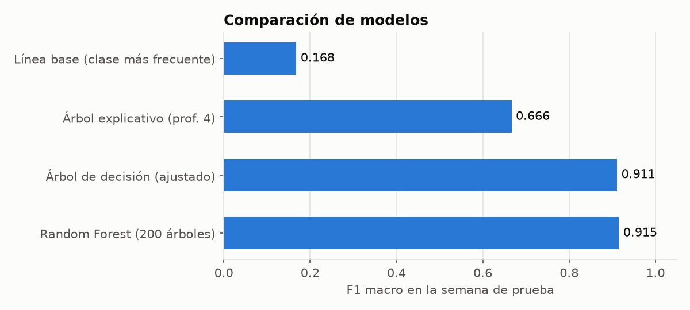
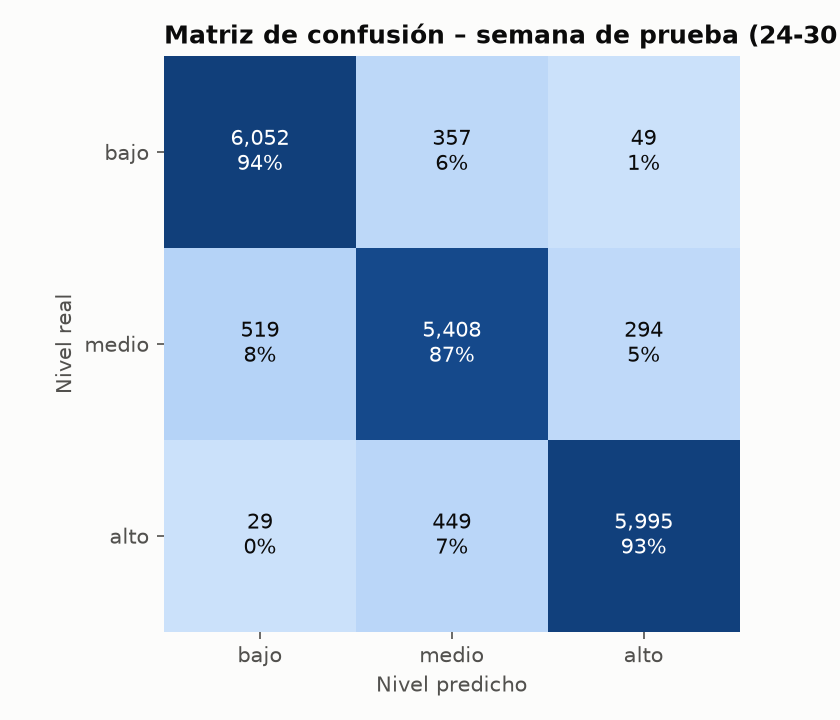
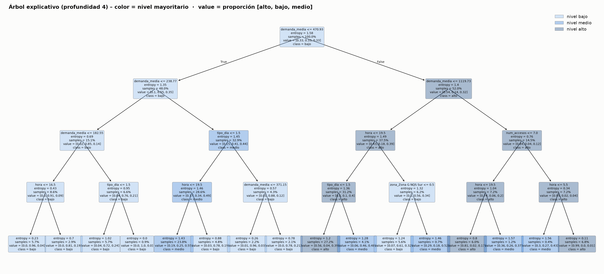
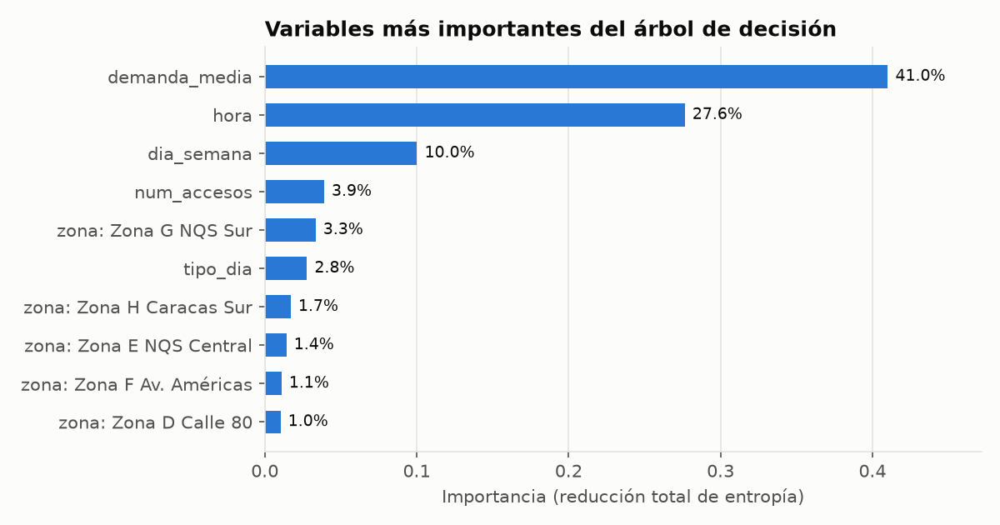

# Documento de pruebas

**Proyecto:** Predicción del nivel de congestión en estaciones troncales de TransMilenio con árboles de decisión
**Componente probado:** pipeline de datos (`src/preparar_datos.py`), modelo (`src/entrenar_modelo.py`) y predictor por consola (`src/predecir.py`)
**Entorno:** Python 3.13 · pandas 3.0 · scikit-learn 1.9 · pytest 9.1

Las pruebas se organizan en cuatro niveles:

1. Evaluación del modelo con datos que nunca vio (semana de prueba).
2. Análisis de errores.
3. Pruebas funcionales del predictor por consola (casos manuales).
4. Pruebas automáticas con `pytest` (42 casos).

---

## 1. Evaluación del modelo

### 1.1 Protocolo

- **Entrenamiento:** días 1 al 23 de abril de 2024 (62.928 ejemplos).
- **Prueba:** días 24 al 30 de abril (19.152 ejemplos), una semana completa con los siete tipos de día. El modelo no ve estos días durante el entrenamiento ni durante la búsqueda de hiperparámetros.
- **Búsqueda de hiperparámetros:** `GridSearchCV` con 32 combinaciones de `max_depth` × `min_samples_leaf`, validación cruzada de 5 particiones **agrupadas por día** (`GroupKFold`), para que las horas de un mismo día no queden repartidas entre entrenamiento y validación. Métrica: F1 macro.
- **Métricas:** exactitud y F1 macro (promedio del F1 de las tres clases; es la más justa con clases balanceadas).

### 1.2 Comparación de modelos

| Modelo | Exactitud (prueba) | F1 macro (prueba) |
|---|---:|---:|
| Línea base: predecir siempre la clase más frecuente | 0,337 | 0,168 |
| Árbol explicativo (profundidad 4, 16 hojas) | 0,671 | 0,666 |
| **Árbol de decisión ajustado** (entropía, min_samples_leaf = 5, profundidad sin límite → 25 niveles, 3.361 hojas) | **0,911** | **0,911** |
| Random Forest (200 árboles, solo como referencia) | 0,916 | 0,915 |



**Lectura de los resultados**

- El árbol ajustado acierta el nivel de congestión en el **91,1 %** de las horas de la semana de prueba, frente al 33,7 % de la línea base.
- Random Forest solo mejora 0,4 puntos de exactitud, así que un único árbol de decisión, más simple y rápido, es suficiente para este problema. Como el árbol ajustado es grande, para interpretarlo se usa el árbol explicativo.
- **Sobreajuste:** la exactitud en entrenamiento es 0,939 y en prueba 0,911. La diferencia es pequeña (2,7 puntos) y el F1 de validación cruzada (0,913) es casi igual al de prueba, lo que indica que el modelo generaliza bien a días nuevos.
- El árbol explicativo de profundidad 4 pierde exactitud (0,671), pero sus 16 reglas se pueden leer y explicar. Sirve para entender qué aprende el modelo (sección 1.5).

### 1.3 Reporte por clase (árbol ajustado, semana de prueba)

```
              precision    recall  f1-score   support

        bajo      0.917     0.937     0.927      6458
       medio      0.870     0.869     0.870      6221
        alto      0.946     0.926     0.936      6473

    accuracy                          0.911     19152
   macro avg      0.911     0.911     0.911     19152
weighted avg      0.912     0.911     0.911     19152
```

### 1.4 Matriz de confusión



| Real \ Predicho | bajo | medio | alto |
|---|---:|---:|---:|
| **bajo** | 6.052 | 357 | 49 |
| **medio** | 519 | 5.408 | 294 |
| **alto** | 29 | 449 | 5.995 |

La mayoría de los errores ocurren entre clases vecinas (bajo↔medio y medio↔alto). Los errores graves, en los que se confunde bajo con alto, son solo 78 de 19.152 (0,4 %).

### 1.5 Verificación de la teoría del capítulo 17

El script recalcula a mano la entropía y la ganancia de información de la primera división del árbol y las compara con el valor interno de scikit-learn:

| Concepto | Valor |
|---|---|
| Entropía del conjunto de entrenamiento H(S) | 1,585 bits (máximo posible con 3 clases: log₂3 = 1,585) |
| Primera división elegida | `demanda_media <= 470.93` |
| Entropía rama izquierda / derecha | 1,347 / 1,398 |
| Ejemplos rama izquierda / derecha | 30.222 / 32.706 |
| **Ganancia de información (cálculo manual)** | **0,2118** |
| Ganancia de información (scikit-learn) | 0,2118 |

Ambos cálculos coinciden, lo que confirma que el árbol escoge en cada nodo el atributo que más reduce la entropía, igual que ID3/C4.5.

Algunas reglas extraídas del árbol explicativo (archivo completo: `resultados/reglas_arbol_explicativo.txt`):

```
R01: SI demanda_media <= 182.5 Y hora <= 16.5 ENTONCES congestión = BAJO   (soporte 5.7%, confianza 96.3%)
R05: SI 238.8 < demanda_media <= 470.9 Y tipo_dia <= 1.5 Y hora <= 19.5 ENTONCES congestión = MEDIO   (soporte 23.8%, confianza 55.4%)
R09: SI 470.9 < demanda_media <= 1119.7 Y hora <= 19.5 Y tipo_dia <= 1.5 ENTONCES congestión = ALTO   (soporte 27.2%, confianza 56.1%)
R13: SI demanda_media > 1119.7 Y num_accesos <= 7.0 Y hora <= 19.5 ENTONCES congestión = ALTO   (soporte 6.0%, confianza 80.9%)
R16: SI demanda_media > 1119.7 Y num_accesos > 7.0 Y hora > 5.5 ENTONCES congestión = ALTO   (soporte 6.8%, confianza 98.6%)
```



### 1.6 Importancia de las variables



La demanda media de la estación y la hora explican cerca del 70 % de las decisiones del árbol, seguidas del día de la semana. Esto concuerda con el perfil horario de los datos: el tamaño de la estación y la hora pico determinan casi todo el comportamiento.

## 2. Análisis de errores

**Exactitud por día de la semana de prueba**

| Fecha | Día | Exactitud |
|---|---|---:|
| 2024-04-24 | miércoles | 92,5 % |
| 2024-04-25 | jueves | 93,1 % |
| 2024-04-26 | viernes | 91,5 % |
| 2024-04-27 | sábado | 86,4 % |
| 2024-04-28 | domingo | 91,5 % |
| 2024-04-29 | lunes | 92,3 % |
| 2024-04-30 | martes | 90,6 % |

**Exactitud por zona troncal**

| Zona | Exactitud |
|---|---:|
| Zona E NQS Central | 85,2 % |
| Zona K Calle 26 | 89,6 % |
| Zona B AutoNorte | 90,7 % |
| Zona L Carrera 10 | 90,8 % |
| Zona F Calle 13 | 91,0 % |
| Zona J Eje Ambiental | 91,3 % |
| Zona G NQS Sur | 91,3 % |
| Zona F Av. Américas | 91,4 % |
| Zona A Caracas | 92,0 % |
| Zona D Calle 80 | 92,3 % |
| Zona H Caracas Sur | 93,1 % |
| Zona T Ciudad Bolívar | 93,5 % |
| Zona C Av. Suba | 93,8 % |

**Estaciones con más errores**

| Estación | Exactitud |
|---|---:|
| Recinto Ferial | 47,6 % |
| U. NACIONAL | 58,7 % |
| EL CAMPIN | 74,6 % |
| Río Fucha | 75,4 % |
| Quiroga | 79,4 % |

**Hallazgos**

1. **Los errores están cerca de los umbrales.** El 81 % de los errores corresponde a horas cuyas salidas están a menos de 100 de uno de los límites entre clases (253 o 603). Son casos en los que la frontera entre "medio" y "alto" es difusa por naturaleza.
2. **Los sábados son el día más difícil** (86,4 % de exactitud): solo hay tres sábados en el periodo de entrenamiento, frente a 17 días hábiles.
3. **Eventos masivos.** Tres de las estaciones con menor exactitud, Recinto Ferial (junto a Corferias), U. Nacional y El Campín, están junto a recintos de eventos masivos. En el caso de Recinto Ferial la causa es clara: la Feria Internacional del Libro (FILBo 2024) se realizó del 17 de abril al 2 de mayo, y las salidas diarias de la estación pasaron de unas 6.000 en las dos primeras semanas a más de 22.000 el sábado 27. La demanda media de la estación se calculó principalmente con días sin feria (16 de los 23 días de entrenamiento), y el modelo no puede anticipar un evento que no está en sus variables (caso de prueba P12).

**Mejoras posibles:** incluir un calendario de eventos (Corferias, El Campín, Movistar Arena), entrenar con varios meses para cubrir festivos y vacaciones, e incorporar las validaciones de entrada.

## 3. Pruebas funcionales del predictor (casos manuales)

Cada caso se ejecutó con `python src/predecir.py`. Para fechas de abril de 2024 el programa muestra también el valor real, lo que permite comprobar la predicción.

| ID | Caso | Entrada | Resultado esperado | Resultado obtenido | Estado |
|---|---|---|---|---|---|
| P1 | Estación intermedia, hora pico, día hábil | Calle 72, lun 29-abr, 7:00 | alto | ALTO (real: 3.604 salidas, alto) | ✅ |
| P2 | Estación con mucha demanda, hora pico | Calle 100, jue 25-abr, 8:00 | alto | ALTO (real: 7.971, alto) | ✅ |
| P3 | Domingo por la tarde | Héroes, dom 28-abr, 15:00 | bajo | BAJO (real: 130, bajo) | ✅ |
| P4 | Pico de la tarde en el centro | Las Aguas, mar 30-abr, 18:00 | alto | ALTO (real: 1.103, alto) | ✅ |
| P5 | Día completo de una estación de transbordo | Ricaurte, mié 24-abr, 5:00–22:00 | Perfil con pico a las 7–8 | 17 de 18 horas correctas | ✅ |
| P6 | Fecha fuera del periodo y festivo | "portal norte", 1-may, 18:00, `--festivo` | Encuentra Cabecera Autopista Norte y predice como domingo | ALTO, sin valor real | ✅ |
| P7 | Nombre con error de digitación | "Ricuarte", vie 26-abr, 7:00 | Encuentra Ricaurte | ALTO (real: 1.043, alto) | ✅ |
| P8 | Nombre ambiguo | "calle" | Error que lista las coincidencias | Error con 25 opciones, código 1 | ✅ |
| P9 | Estación inexistente | "xyz" | Mensaje de error claro | "No se encontró la estación", código 1 | ✅ |
| P10 | Hora fuera de operación | 2:00 | Error de validación | "La hora debe estar entre 5 y 22", código 1 | ✅ |
| P11 | Formato de fecha inválido | 24/04/2024 | Error de validación | "Use el formato AAAA-MM-DD", código 1 | ✅ |
| P12 | Caso de falla conocido (evento) | Recinto Ferial, sáb 27-abr, día completo | Debe mostrar la limitación | 7 de 18 horas correctas: no anticipa la FILBo | ⚠️ Limitación documentada |

### Salidas de consola

**P1**

```
$ python src/predecir.py --estacion "Calle 72" --fecha 2024-04-29 --hora 7
Estación: Calle 72 (09122) – Zona A Caracas
Fecha:    2024-04-29 (lunes, hábil)
Niveles:  bajo <= 253 < medio <= 603 < alto  (salidas por hora)

Hora 07:00 -> congestión ALTO
Probabilidades: bajo 0% | medio 0% | alto 100%
Explicación (árbol de profundidad 4): SI 470.9 < demanda_media <= 1119.7 Y hora <= 19.5 Y tipo_dia <= 1.5 ENTONCES alto
Valor real: 3,604 salidas -> alto (acierto; día del periodo de prueba)
[código de salida: 0]
```

**P2**

```
$ python src/predecir.py --estacion "calle 100" --fecha 2024-04-25 --hora 8
Estación: Calle 100 - Marketmedios (02300) – Zona B AutoNorte
Fecha:    2024-04-25 (jueves, hábil)
Niveles:  bajo <= 253 < medio <= 603 < alto  (salidas por hora)

Hora 08:00 -> congestión ALTO
Probabilidades: bajo 0% | medio 0% | alto 100%
Explicación (árbol de profundidad 4): SI demanda_media > 1119.7 Y num_accesos <= 7.0 Y hora <= 19.5 ENTONCES alto
Valor real: 7,971 salidas -> alto (acierto; día del periodo de prueba)
[código de salida: 0]
```

**P3**

```
$ python src/predecir.py --estacion heroes --fecha 2024-04-28 --hora 15
Estación: Heroes - Gel hada (02304) – Zona B AutoNorte
Fecha:    2024-04-28 (domingo, domingo/festivo)
Niveles:  bajo <= 253 < medio <= 603 < alto  (salidas por hora)

Hora 15:00 -> congestión BAJO
Probabilidades: bajo 100% | medio 0% | alto 0%
Explicación (árbol de profundidad 4): SI 470.9 < demanda_media <= 1119.7 Y hora <= 19.5 Y tipo_dia > 1.5 ENTONCES medio
Valor real: 130 salidas -> bajo (acierto; día del periodo de prueba)
[código de salida: 0]
```

**P4**

```
$ python src/predecir.py --estacion "las aguas" --fecha 2024-04-30 --hora 18
Estación: Las Aguas - Centro Colombo Americano (14005) – Zona J Eje Ambiental
Fecha:    2024-04-30 (martes, hábil)
Niveles:  bajo <= 253 < medio <= 603 < alto  (salidas por hora)

Hora 18:00 -> congestión ALTO
Probabilidades: bajo 0% | medio 0% | alto 100%
Explicación (árbol de profundidad 4): SI 470.9 < demanda_media <= 1119.7 Y hora <= 19.5 Y tipo_dia <= 1.5 ENTONCES alto
Valor real: 1,103 salidas -> alto (acierto; día del periodo de prueba)
[código de salida: 0]
```

**P5**

```
$ python src/predecir.py --estacion ricaurte --fecha 2024-04-24 --dia-completo
Estación: Ricaurte (12003) – Zona F Calle 13
Fecha:    2024-04-24 (miércoles, hábil)
Niveles:  bajo <= 253 < medio <= 603 < alto  (salidas por hora)

Hora  Nivel   P(bajo) P(medio) P(alto)   Salidas reales  Nivel real
05:00 medio       0%     100%      0%  ▄▄       310  medio  ✓
06:00 medio       0%      67%     33%  ▄▄       537  medio  ✓
07:00 alto        0%       0%    100%  ███    1,046  alto   ✓
08:00 alto        0%       0%    100%  ███    1,042  alto   ✓
09:00 medio       0%     100%      0%  ▄▄       545  medio  ✓
10:00 medio       0%     100%      0%  ▄▄       448  medio  ✓
11:00 medio       0%     100%      0%  ▄▄       452  medio  ✓
12:00 medio       0%     100%      0%  ▄▄       386  medio  ✓
13:00 medio       0%     100%      0%  ▄▄       322  medio  ✓
14:00 medio       0%     100%      0%  ▄▄       311  medio  ✓
15:00 medio       0%     100%      0%  ▄▄       278  medio  ✓
16:00 bajo       73%      27%      0%  ▁        282  medio  ✗
17:00 bajo      100%       0%      0%  ▁        215  bajo   ✓
18:00 bajo      100%       0%      0%  ▁        190  bajo   ✓
19:00 bajo      100%       0%      0%  ▁         75  bajo   ✓
20:00 bajo      100%       0%      0%  ▁         77  bajo   ✓
21:00 bajo      100%       0%      0%  ▁         57  bajo   ✓
22:00 bajo      100%       0%      0%  ▁         46  bajo   ✓

Aciertos: 17/18 horas (día del periodo de prueba)
[código de salida: 0]
```

**P6**

```
$ python src/predecir.py --estacion "portal norte" --fecha 2024-05-01 --hora 18 --festivo
Estación: Cabecera Autopista Norte (02000) – Zona B AutoNorte
Fecha:    2024-05-01 (miércoles, domingo/festivo)
Niveles:  bajo <= 253 < medio <= 603 < alto  (salidas por hora)

Hora 18:00 -> congestión ALTO
Probabilidades: bajo 0% | medio 0% | alto 100%
Explicación (árbol de profundidad 4): SI demanda_media > 1119.7 Y num_accesos > 7.0 Y hora > 5.5 ENTONCES alto
[código de salida: 0]
```

**P7**

```
$ python src/predecir.py --estacion Ricuarte --fecha 2024-04-26 --hora 7
Estación: Ricaurte (12003) – Zona F Calle 13
Fecha:    2024-04-26 (viernes, hábil)
Niveles:  bajo <= 253 < medio <= 603 < alto  (salidas por hora)

Hora 07:00 -> congestión ALTO
Probabilidades: bajo 0% | medio 0% | alto 100%
Explicación (árbol de profundidad 4): SI 238.8 < demanda_media <= 470.9 Y tipo_dia <= 1.5 Y hora <= 19.5 ENTONCES medio
Valor real: 1,043 salidas -> alto (acierto; día del periodo de prueba)
[código de salida: 0]
```

**P8**

```
$ python src/predecir.py --estacion calle --fecha 2024-04-24 --hora 8
Error: 'calle' es ambiguo. Coincide con: Av. Suba- Calle 116, Cabecera Calle 80, Calle 100 - Marketmedios, Calle 106, Calle 127, Calle 142, Calle 146, Calle 161, Calle 19, Calle 22, Calle 26, Calle 34, Calle 40 Sur, Calle 45, Calle 57, Calle 63, Calle 72, Calle 75 - Zona M, Calle 76 - San Felipe, Calle 85, NIZA - CALLE 127, NQS - Calle 30 Sur, NQS - Calle 38A Sur, SUBA - CALLE 100, SUBA - CALLE 95
[código de salida: 1]
```

**P9**

```
$ python src/predecir.py --estacion xyz --fecha 2024-04-24 --hora 8
Error: No se encontró la estación 'xyz'.
[código de salida: 1]
```

**P10**

```
$ python src/predecir.py --estacion "Calle 72" --fecha 2024-04-24 --hora 2
Error: La hora debe estar entre 5 y 22 (horario modelado de operación troncal).
[código de salida: 1]
```

**P11**

```
$ python src/predecir.py --estacion "Calle 72" --fecha 24/04/2024 --hora 8
Error: Fecha inválida '24/04/2024'. Use el formato AAAA-MM-DD.
[código de salida: 1]
```

### P12 – Caso de falla documentado (Recinto Ferial durante la FILBo)

```
$ python src/predecir.py --estacion "recinto ferial" --fecha 2024-04-27 --dia-completo
Estación: Recinto Ferial (06106) – Zona K Calle 26
Fecha:    2024-04-27 (sábado, sábado)
Niveles:  bajo <= 253 < medio <= 603 < alto  (salidas por hora)

Hora  Nivel   P(bajo) P(medio) P(alto)   Salidas reales  Nivel real
05:00 bajo      100%       0%      0%  ▁        122  bajo   ✓
06:00 medio       0%     100%      0%  ▄▄       403  medio  ✓
07:00 medio       0%      83%     17%  ▄▄       599  medio  ✓
08:00 medio       0%      83%     17%  ▄▄       811  alto   ✗
09:00 medio       0%      67%     33%  ▄▄     1,339  alto   ✗
10:00 bajo       67%       0%     33%  ▁      2,514  alto   ✗
11:00 bajo       67%       0%     33%  ▁      2,672  alto   ✗
12:00 bajo       67%       0%     33%  ▁      2,776  alto   ✗
13:00 bajo       67%       0%     33%  ▁      2,613  alto   ✗
14:00 bajo       67%       0%     33%  ▁      2,726  alto   ✗
15:00 bajo       67%       0%     33%  ▁      2,239  alto   ✗
16:00 bajo       67%       0%     33%  ▁      1,482  alto   ✗
17:00 bajo       50%      50%      0%  ▁        730  alto   ✗
18:00 bajo       83%      17%      0%  ▁        370  medio  ✗
19:00 bajo       67%      33%      0%  ▁        227  bajo   ✓
20:00 bajo      100%       0%      0%  ▁        225  bajo   ✓
21:00 bajo      100%       0%      0%  ▁        141  bajo   ✓
22:00 bajo      100%       0%      0%  ▁         82  bajo   ✓

Aciertos: 7/18 horas (día del periodo de prueba)
```

## 4. Pruebas automáticas (`pytest`)

Ejecución:

```
python -m pytest -v
```

Resultado: **42 pruebas superadas, 0 fallidas**.

| # | Archivo | Prueba | Qué verifica |
|---|---|---|---|
| 1 | test_datos.py | `test_separador_de_miles` | Convierte '1.026' en 1026 (separador de miles del archivo) |
| 2 | test_datos.py | `test_separar_codigo_y_nombre` | Separa el código y el nombre de estaciones y zonas |
| 3 | test_datos.py | `test_tipo_de_dia_abril_2024[1-0]` | Clasifica bien hábil, sábado y domingo (1 de abril de 2024 = lunes) |
| 4 | test_datos.py | `test_tipo_de_dia_abril_2024[5-0]` | Clasifica bien hábil, sábado y domingo (1 de abril de 2024 = lunes) |
| 5 | test_datos.py | `test_tipo_de_dia_abril_2024[6-1]` | Clasifica bien hábil, sábado y domingo (1 de abril de 2024 = lunes) |
| 6 | test_datos.py | `test_tipo_de_dia_abril_2024[7-2]` | Clasifica bien hábil, sábado y domingo (1 de abril de 2024 = lunes) |
| 7 | test_datos.py | `test_tipo_de_dia_abril_2024[8-0]` | Clasifica bien hábil, sábado y domingo (1 de abril de 2024 = lunes) |
| 8 | test_datos.py | `test_festivo_cuenta_como_domingo` | Un festivo se clasifica como domingo/festivo |
| 9 | test_datos.py | `test_normalizar_quita_tildes_y_signos` | Normaliza nombres para la búsqueda |
| 10 | test_datos.py | `test_limpiar_elimina_vacias_corrales_y_valida_total` | Elimina filas vacías y corrales, y detecta totales inconsistentes |
| 11 | test_datos.py | `test_etiquetar_por_umbrales` | Asigna bajo/medio/alto según los umbrales |
| 12 | test_datos.py | `test_umbrales_dan_clases_balanceadas` | Los terciles generan clases balanceadas |
| 13 | test_datos.py | `test_entropia_casos_conocidos` | Entropía: 0 si es puro, 1 con 2 clases iguales, log₂3 con 3 |
| 14 | test_datos.py | `test_ganancia_division_perfecta_y_nula` | Ganancia de información de una división perfecta y de una inútil |
| 15 | test_datos.py | `test_archivo_original_tiene_estructura_esperada` | El CSV original tiene las columnas esperadas |
| 16 | test_datos.py | `test_limpieza_conserva_las_salidas` | La limpieza no pierde ni inventa salidas |
| 17 | test_datos.py | `test_dataset_por_hora_completo_y_sin_duplicados` | Una fila por estación-día-hora, sin duplicados ni negativos |
| 18 | test_datos.py | `test_agregacion_por_hora_coincide_con_original` | La suma por hora coincide con los registros de 15 min |
| 19 | test_datos.py | `test_calendario_correcto` | Fechas, día de la semana y tipo de día correctos |
| 20 | test_datos.py | `test_archivo_procesado_coincide_con_regenerado` | El CSV procesado del repositorio es reproducible |
| 21 | test_modelo.py | `test_desempeno_en_semana_de_prueba` | Exactitud y F1 macro ≥ 0,85 en la semana de prueba |
| 22 | test_modelo.py | `test_supera_ampliamente_a_la_linea_base` | Supera a la línea base por más de 40 puntos |
| 23 | test_modelo.py | `test_arbol_explicativo_es_pequeno_y_util` | El árbol explicativo tiene ≤ 16 hojas y exactitud ≥ 0,60 |
| 24 | test_modelo.py | `test_sin_fuga_de_informacion` | Umbrales y demanda media se calcularon solo con entrenamiento |
| 25 | test_modelo.py | `test_prediccion_devuelve_clases_y_probabilidades_validas` | Clases válidas y probabilidades que suman 1 |
| 26 | test_modelo.py | `test_casos_de_sentido_comun` | Hora pico en estación grande → alto; domingo de noche en estación pequeña → bajo |
| 27 | test_modelo.py | `test_festivo_se_trata_como_domingo` | Un festivo se predice como un domingo y distinto a un día hábil |
| 28 | test_modelo.py | `test_explicacion_coincide_con_arbol_explicativo` | La regla mostrada coincide con la predicción del árbol explicativo |
| 29 | test_modelo.py | `test_buscar_estacion[09122-Calle 72]` | Busca por código, sin tildes, con alias o con errores de digitación |
| 30 | test_modelo.py | `test_buscar_estacion[calle 72-Calle 72]` | Busca por código, sin tildes, con alias o con errores de digitación |
| 31 | test_modelo.py | `test_buscar_estacion[HEROES-Heroes - Gel hada]` | Busca por código, sin tildes, con alias o con errores de digitación |
| 32 | test_modelo.py | `test_buscar_estacion[portal norte-Cabecera Autopista Norte]` | Busca por código, sin tildes, con alias o con errores de digitación |
| 33 | test_modelo.py | `test_buscar_estacion[Ricuarte-Ricaurte]` | Busca por código, sin tildes, con alias o con errores de digitación |
| 34 | test_modelo.py | `test_buscar_estacion[museo del oro-Museo del Oro]` | Busca por código, sin tildes, con alias o con errores de digitación |
| 35 | test_modelo.py | `test_buscar_estacion_ambigua_o_inexistente[calle]` | Rechaza nombres ambiguos, inexistentes o vacíos |
| 36 | test_modelo.py | `test_buscar_estacion_ambigua_o_inexistente[xyz123]` | Rechaza nombres ambiguos, inexistentes o vacíos |
| 37 | test_modelo.py | `test_buscar_estacion_ambigua_o_inexistente[   ]` | Rechaza nombres ambiguos, inexistentes o vacíos |
| 38 | test_modelo.py | `test_hora_fuera_de_operacion[0]` | Rechaza horas fuera de 5–22 |
| 39 | test_modelo.py | `test_hora_fuera_de_operacion[4]` | Rechaza horas fuera de 5–22 |
| 40 | test_modelo.py | `test_hora_fuera_de_operacion[23]` | Rechaza horas fuera de 5–22 |
| 41 | test_modelo.py | `test_hora_fuera_de_operacion[30]` | Rechaza horas fuera de 5–22 |
| 42 | test_modelo.py | `test_cli_codigos_de_salida` | El programa devuelve 0 si funciona y 1 si hay error |

## 5. Conclusión

El componente cumple su objetivo. Con un árbol de decisión entrenado con datos abiertos reales de TransMilenio se predice el nivel de congestión de cada estación troncal, por hora, con un **91,1 % de exactitud** en una semana que el modelo nunca vio, muy por encima de la línea base (33,7 %) y casi igual que un Random Forest. El árbol explicativo y las reglas SI-ENTONCES muestran que el modelo aprendió patrones razonables: el tamaño de la estación, la hora pico y el tipo de día. La principal limitación es la falta de información sobre eventos masivos, que se identificó y documentó con un caso real (FILBo 2024).
